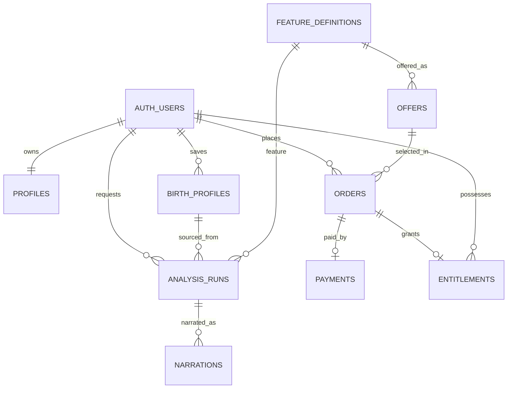

# Supabase PostgreSQL 데이터베이스 상세설계 — v2.4

> 목표: 사용자/출생정보/분석 이력/LLM 서술/기능 카탈로그/테스트 주문·결제·권한을 독립 관리한다. **SQL은 실제 Supabase 인스턴스에서 실행·테스트하지 않은 초기 마이그레이션 초안**이다. `db/migrations/0001_initial.sql` 참조. 실계정 연결 전 로컬 DB/RLS 검증이 필요하다.

> **현행 v2.4 저장 모델**: `0001_initial.sql`에서 기본 애플리케이션 10개 테이블, `0002_reading_conversations.sql`에서 `reading_conversations`/`reading_messages` 2개를 추가해 **총 12개**. PostgreSQL/Supabase 관리 `auth.users`는 별도. 저장형 P06은 R02/R03 스트리밍 메시지를 사용한다. **동시 스트림 원자 차단·소유권·접근권·멱등 검증은 서버 필수**.

## ERD 요약

## 테이블 설계

|테이블|핵심 컬럼|책임/주의사항|
|---|---|---|
|`auth.users`|Supabase 관리 ID·공급자 연결|별도 생성 금지, Supabase Auth 소유|
|`public.profiles`|`id`(auth.users FK), `display_name`, 시각|공용 계정 프로필. 소셜 이메일은 필수 아님|
|`public.birth_profiles`|`id`, `user_id`, 생년월일/시각, 음양력·윤달·TZ·경도, `direction_basis`|소유자 출생정보; 궁합 상대 정보도 동의받은 소유자 관리 자료로 취급|
|`public.feature_definitions`|`feature_id` F01~F11, group, enabled|기능 코드의 진실원천, 상품명/가격 아님|
|`public.analysis_runs`|`user_id`, `birth_profile_id`, `feature_id`, `result_json`, 정책·규칙 버전|검증 가능한 결정적 명리 분석 저장. 무료 체험 미보관 가능|
|`public.narrations`|`analysis_run_id`, `persona_id/version`, 모델·프롬프트 버전, `output_json`|캐릭터 서술 결과 분리. 캐릭터 변경 시 원국 재계산 불필요|
|`public.offers`|`id`, `feature_id`, `code`, `price_krw`, `environment=test`|가격 스냅샷의 기준. **실제 가격 미정**|
|`public.orders`|`id`, `user_id`, `offer_id`, `order_code`, `amount_krw`, 상태·환경|서버에서만 주문 생성; 클라이언트 가격 불신|
|`public.payments`|`order_id`, `provider`, `payment_key`, PG 상태/승인액|PG 확인 이후 서버에서만 작성|
|`public.entitlements`|`user_id`, `order_id`, `feature_id`, `environment=test`, 상태|해당 기능 테스트 접근권. 운영 권한 불인정|
|`public.payment_webhook_events`|전송 ID, 이벤트 타입, 처리 시간/상태|중복/재처리 추적, 결제 조회 검증 필요|

**개인정보 최소화**: 이름/휴대폰번호/주민번호는 수집하지 않는다. 출생일시·출생장소는 계산에 필요한 범위로 제한. 상대방의 생년정보를 저장할 때는 동의·삭제 절차를 별도로 고려한다. 분석 JSON/LLM 서술에도 개인 데이터가 포함될 수 있으므로 접근 제한과 보관 기간 관리가 필요하다.

## 주요 관계 및 무결성

- `profiles.id = auth.users.id`: 로그인 유저 1:1; 공급자별 계정과 별개로 profile 1건.
- `birth_profiles.user_id`: 해당 사용자만 CRUD 가능. 시간 미상이라면 `birth_time IS NULL` 일관성 검사.
- `analysis_runs.user_id`, `birth_profile_id`: 서버 입력 검증에서 두 ID의 소유자 일치 보장. 궁합 상대 프로필은 같은 사용자 소유 데이터 또는 별도 명시적 동의 흐름.
- `orders.offer_id`와 `price_krw`를 **주문 시점 스냅샷**으로 보존; 이후 상품 가격이 변해도 과거 주문은 바뀌지 않는다.
- `orders.order_code UNIQUE`, `payments.payment_key UNIQUE`, `payments.order_id UNIQUE`, `entitlements.order_id UNIQUE`로 중복 승인·권한 중복을 제어.
- `narrations`는 `analysis_run_id` 및 `(persona_id, persona_version, prompt_version, model_id)`를 기록. 분석 규칙 결과 변경은 별도 `analysis_runs`를 생성.
- PG `orderId`는 `orders.order_code`에 매핑. `order_code`는 무작위 UUID 기반 ASCII 코드를 권장.

## RLS와 백엔드 접근 경계

- 모든 사용자 관련 public 테이블에 **RLS 활성화** 및 `auth.uid() = user_id` 정책.
- 사용자 클라이언트는 본인 `profiles`, `birth_profiles`만 제한된 쓰기 권한. `analysis_runs`, `narrations`, `orders`, `payments`, `entitlements`는 **필요한 컬럼 읽기만 허용** (예: `payments.payment_key`는 클라이언트 SELECT 금지)하며 생성·승인·권한 부여는 로그인 인증 후 서버 전용 신뢰 경로가 수행.
- `feature_definitions`, 활성 `offers`는 공개 읽기 가능. **PG 가격도 읽을 수 있지만 결제 승인 가격 검증은 서버 DB 기준**.
- 서버 관리 키는 브라우저·클라이언트 번들에 포함하지 않는다. RLS를 우회하는 서비스 키 사용 전에 서버가 사용자 소유권·동작 권한을 재검증한다.
- 민감 응답은 `Cache-Control: private, no-store`; 조회 API `user_id`를 임의 클라이언트 파라미터로 받아 신뢰하지 않는다.

## 주문 트랜잭션 규칙

`orders` 생성 → PG 승인 성공 확인 → DB 트랜잭션(`payments` UPSERT + `orders.status=paid_test` + `entitlements` INSERT ON CONFLICT DO NOTHING). 단일 API 요청에서 여러 DB 쓰기가 실패할 수 있으므로 저장 프로시저/RPC 또는 명시적 트랜잭션을 도입한다. 승인 결과 기록과 권한 지급을 별도 비원자적 요청으로 나누지 않는다.

> 결제 비즈니스 로직을 Supabase `security definer` RPC로 구현한다면 `search_path` 고정, `EXECUTE` 권한 revoke/grant, public exposed schema 노출 범위, 서버 호출 권한 검증을 필수로 한다. 본 SQL 초안에는 위험한 광역 RPC를 넣지 않는다.

## 스키마 버전/캐시

- `analysis_runs`: `schema_version`, `calculation_policy_version`, `rules_version`, `library_version`, `input_hash`, feature-target `jsonb`.
- `narrations`: `persona_id`, `persona_version`, `prompt_version`, `model_id`, `output_schema_version`, token metadata.
- 민감 원문은 캐시 키로 사용하지 않는다. 사용자·버전·정규화된 비식별 입력 해시 기반 캐시; 삭제 요청시 관련 분석/서술도 삭제.

## 데이터 삭제/보관

1. 출생 프로필 삭제 시 연결 분석·서술을 함께 삭제할지 확인하는 UX 필요. SQL FK 정책을 검토하고 소유자의 삭제 요청을 안전한 서버 흐름으로 실행.
2. 테스트 주문·결제 내역은 데이터 최소화 원칙 및 정산/감사 필요에 따라 별도 보관기간을 정한다. 계정 탈퇴 요청 시 법정 보존이 필요한 운영 거래와 구분한다.
3. 공급자 로그인 해제는 별도 Auth API 흐름; DB `DELETE`만으로 연결 소셜 계정이 삭제되었다고 표시하면 안 된다.

## 검증 시나리오

- 사용자 A는 B의 출생 프로필, 분석, 주문, 결제, 권한을 SELECT/UPDATE/DELETE 불가.
- 미로그인 사용자는 보호 테이블 0건 반환/403; 공개 `feature_definitions`만 조회.
- 클라이언트가 `orders.status` 또는 `entitlements`를 직접 업데이트하려 해도 거부.
- 테스트 키를 가진 PG 승인만 `paid_test`; PG 실제 승인 아닌 임의 success URL은 권한 없음.
- 같은 주문을 동시에 확인해도 결제 1건, 테스트 권한 1건.
- 출생시간 미상/음력 윤달/국외 시간대 입력과 JSON 버전 저장 정합성.
- 기존 기능 F01~F11이 어떤 데이터만 필요로 하는지 API/DB 소비 관계를 통합 테스트.

## 참고
- https://supabase.com/docs/guides/database/postgres/row-level-security
- https://supabase.com/docs/guides/auth
- https://supabase.com/docs/guides/auth/server-side/creating-a-client

---

## 대화형 풀이 테이블(v2.4 필수)

|테이블|주요 내용|관계 및 규칙|
|---|---|---|
|`reading_conversations`|owner, analysis_run_id, persona/model/prompt 버전, report_status, 섹션 계획·총수|`(analysis_run_id,user_id)` 복합 FK, 사용자 자신만 SELECT, 완료 상태 서버 트랜잭션 관리|
|`reading_messages`|conversation_id, 순번, assistant/user, report/followup, content, evidence_ids, request_id|세션 소유자 복합 FK, 검증된 완료 메시지만 저장, 중복 방지|

`report.completed`는 모든 섹션의 검증·저장·상태 커밋이 끝난 후에만 송신하며 그 전에는 R03 질문 API가 `409 REPORT_NOT_COMPLETE`를 반환한다. OpenAI 스트림 델타는 DB에 검증 완료 데이터처럼 저장하지 않는다.

### 미완료·복구

- 클라이언트가 연결이 끊기면 GET 상태로 저장된 완료 섹션만 복원한다. 미완료 섹션은 서버가 다시 생성한다.
- `request_id`와 DB 잠금/서버 실행 잠금을 함께 활용해 중복 스트리밍/중복 메시지를 방지한다.
- 읽기 RLS만으로 서비스 역할의 쓰기 권한이 제한되지는 않으므로 서버에서 본인 소유/권한/세션 상태를 재확인한다.
- 실제 마이그레이션을 실행하지 않았으며 외래키, RLS, 상태 전이, 삭제 cascade는 테스트 DB에서 검증해야 한다.
